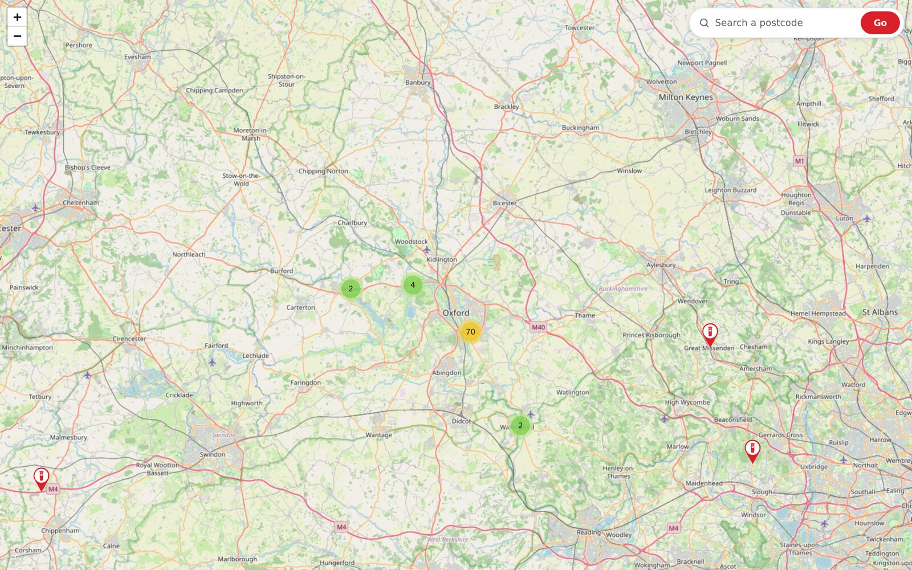
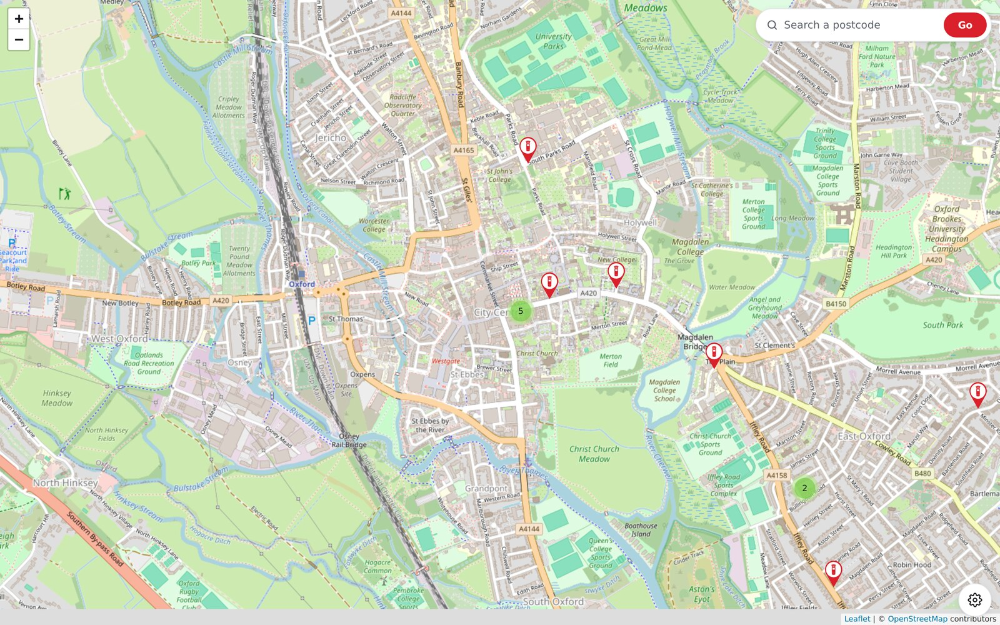
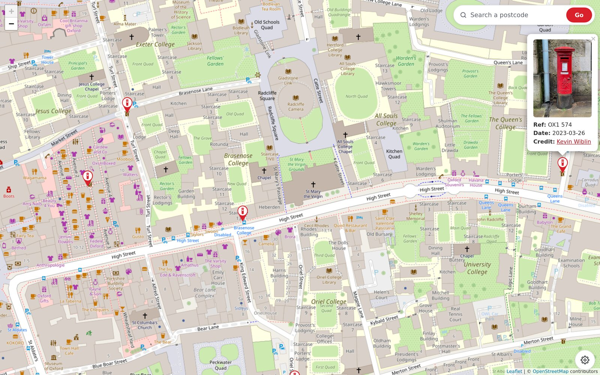
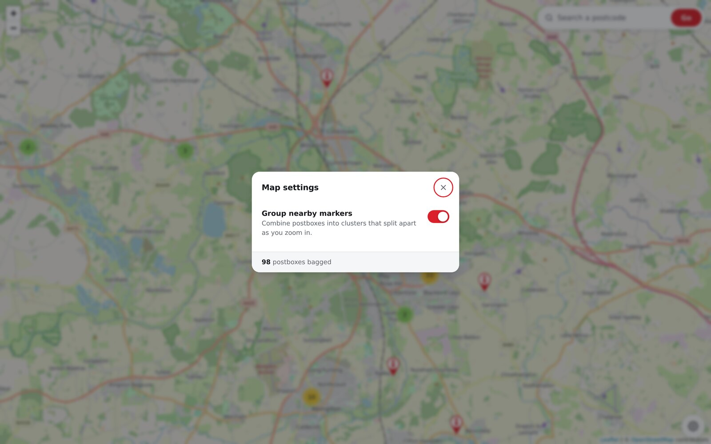
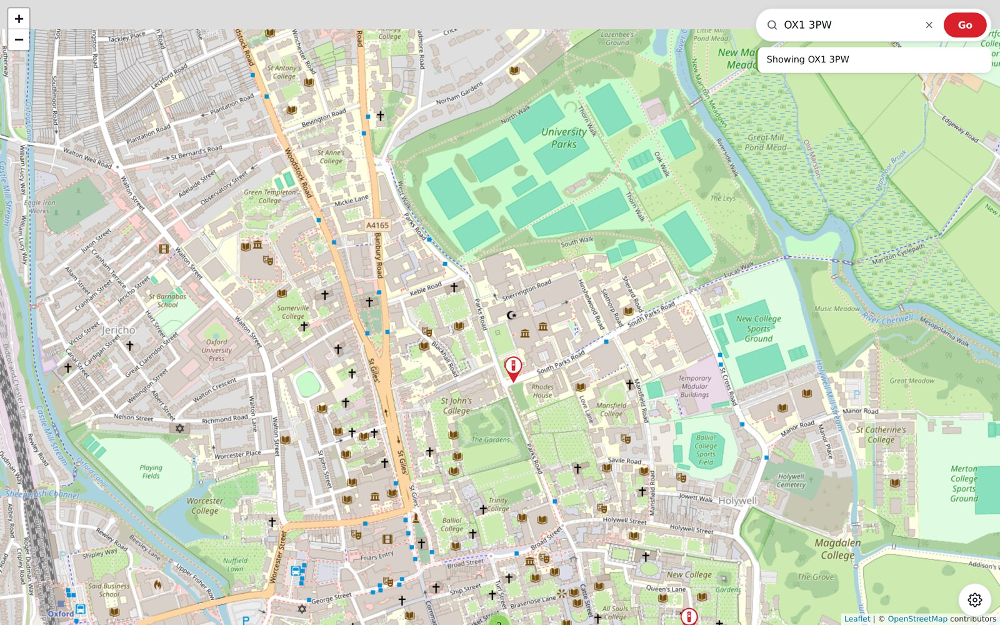
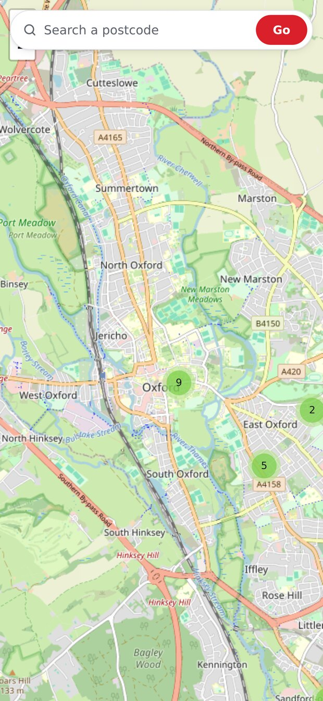
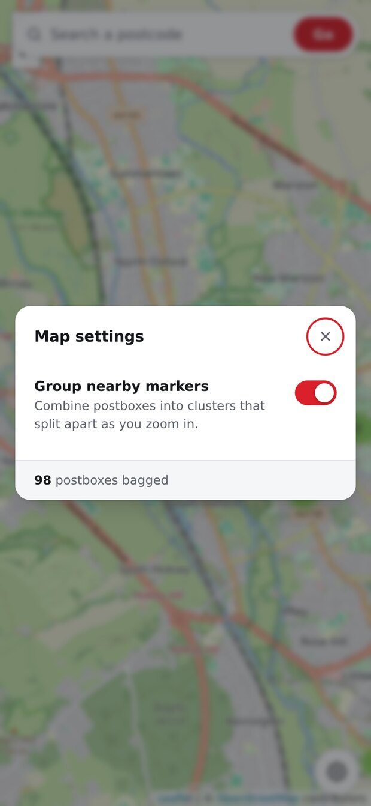

# Postbox Map

A Leaflet map of UK postboxes that have been visited and photographed
("bagged"). Live at <https://postboxes.wiblin.uk/>.

Each marker is a postbox. Clicking one opens a popup with the photograph, the
Royal Mail box reference, the date it was bagged, and a credit link.



## Stack

Deliberately plain — no build step, no package manager, no framework.

- **Frontend:** vanilla JavaScript with [Leaflet](https://leafletjs.com/) 1.7.1
  and [Leaflet.markercluster](https://github.com/Leaflet/Leaflet.markercluster)
  1.4.1, both loaded from unpkg. Tiles from OpenStreetMap.
- **Backend:** a single PHP endpoint reading from MySQL.
- **Photos:** served from `cdn.wiblin.net`, not from this repository.

## Files

| File | Purpose |
| --- | --- |
| `index.php` | Page shell, search field, settings cog and modal; renders its own meta tags from the config |
| `styles.css` | All styling: controls, modal, and Leaflet overrides |
| `app.js` | Map setup, marker rendering, popups, search, settings |
| `get_markers.php` | The only endpoint the frontend calls; returns markers as JSON |
| `config.example.php` | Template for the config: credentials, URLs, map start |
| `schema.sql` | Table definition and a couple of example rows |
| `icons/` | Red and green map pins |
| `screenshots/` | Interface screenshots used in this README |

Not tracked in git, but present in a working deployment:

- `config.php` — real settings, created from `config.example.php`
- `images/` — local copies of the photographs (the site loads them from the CDN)
- `csv/` — scratch tooling used to gather postbox locations, described below

## Setup

1. Create the database and table:

   ```sh
   mysql -u root -p -e "CREATE DATABASE image_map_db \
     CHARACTER SET utf8mb4 COLLATE utf8mb4_0900_ai_ci;"
   mysql -u root -p image_map_db < schema.sql
   ```

2. Create the application user. Grant it access to this database only, and use
   a real password:

   ```sql
   CREATE USER 'image_map_user'@'localhost' IDENTIFIED BY 'a-real-password';
   GRANT SELECT, INSERT, UPDATE, DELETE ON image_map_db.* TO 'image_map_user'@'localhost';
   ```

3. Copy the config template and fill it in:

   ```sh
   cp config.example.php config.php
   ```

   `config.php` is git-ignored and must stay that way. It returns an array and
   prints nothing, so requesting it over HTTP yields an empty response — but it
   still sits inside the document root, so it is only as private as your PHP
   handler is reliable. Moving it above the web root and adjusting the
   `require` in `get_markers.php` is the sturdier arrangement.

4. Serve the directory with PHP available. There is nothing to build.

MySQL should listen on `127.0.0.1` only; nothing here needs it exposed.

## Configuration

`config.php` is the single place the site is described. Nothing else hardcodes
a URL, a credential or a starting position.

| Key | Used for |
| --- | --- |
| `db.*` | Credentials for `get_markers.php` |
| `site.title` | `<title>`, `og:title`, `og:site_name` |
| `site.description` | Meta description and both social cards |
| `site.url` | `<link rel="canonical">`, `og:url`, `twitter:url` |
| `site.image_base` | Prefix for marker photographs; the `image_url` column holds only a filename |
| `site.social_image` | The single image used for link previews |
| `site.twitter` | Handle for the Twitter card. Leave empty to omit those tags entirely |
| `map.lat` / `map.lng` / `map.zoom` | Where the map opens before the user moves it |

`index.php` renders the head from these values and passes `image_base` and the
map start to the browser as `window.POSTBOX_CONFIG`. Everything interpolated
into the markup is escaped, and the JSON is encoded with the `JSON_HEX_*` flags
so no value can close the script element early.

`app.js` falls back to sensible defaults if that global is absent, so it still
runs if loaded from a page that does not set it.

## How markers work

`get_markers.php` returns every row as JSON. `app.js` draws each one into a
marker cluster group and picks the pin colour from whether the row has a date:

- **Red** — bagged. Has a `date`, and usually an `image_url`. Pillar-box red,
  to match the thing being mapped.
- **Green** — a known location that has not been visited yet.

**A quirk worth knowing:** the query in `get_markers.php` filters on
`WHERE date > '1970-01-01'`, so rows without a date never reach the browser.
Every marker the map receives therefore has a date and renders red, and the
green pin is currently unreachable. The `markers` table does hold unvisited
locations — they simply are not published. Dropping the `WHERE` clause would
put them on the map in green.

## Controls

The **cog** in the bottom-right corner opens a settings dialog. It closes on
Escape or a backdrop click, traps Tab within itself while open, and returns
focus to the cog afterwards. It currently holds one setting — whether markers
are grouped into clusters — which is remembered in `localStorage` under
`postboxes:cluster` and applied before the first render.

The **search field** geocodes a UK postcode through
[postcodes.io](https://postcodes.io/) and recentres the map at zoom 16. It
shows a spinner while the request is in flight and reports the outcome inline
beneath the field through an `aria-live` region, rather than in a blocking
`alert()`.

## Screenshots

More of the interface, in `screenshots/`:

| | |
| --- | --- |
| [](screenshots/markers.jpg) | [](screenshots/popup.jpg) |
| Individual pins once clusters break apart | A popup with photo, reference, date and credit |
| [](screenshots/settings.jpg) | [](screenshots/search.jpg) |
| The settings dialog behind the cog | A postcode search and its inline result |

 

## Where the data came from

The `csv/` directory holds one-off scripts used to assemble the postbox list.
They are not part of the running site and are not tracked in git, but they
document the provenance:

- Overpass API queries for `amenity=post_box` within a named county or a
  postcode-district bounding box, output as JSON, CSV or an HTML table.
- `convert.php`, which reprojects Royal Mail eastings and northings from
  OSGB36 (EPSG:27700) to WGS84 latitude/longitude (EPSG:4326) using
  [proj4php](https://github.com/proj4php/proj4php).

### Data licensing

The MIT license below covers the code in this repository. It does not, and
cannot, relicense the underlying location data:

- Coordinates derived from OpenStreetMap are
  © OpenStreetMap contributors, available under the
  [Open Database License](https://www.openstreetmap.org/copyright) (ODbL).
  Reusing them carries attribution and share-alike obligations.
- Box references and collection times originate from Royal Mail data. Check
  their terms before redistributing.
- The photographs are © Kevin Wiblin and are not covered by the MIT license.

## Known rough edges

- Leaflet is pinned to 1.7.1 from a CDN with no integrity hash.
- `get_markers.php` returns the whole table on every request. Fine at a few
  hundred markers; it would want paging or bounding-box filtering well before
  a few thousand.

## License

[MIT](LICENSE) — see the data licensing note above for the important caveat.
